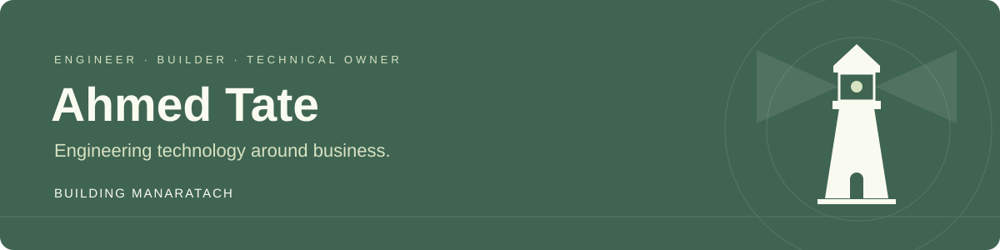

  

# Ahmed Tate

**Computer Engineer · Technology & Innovation · Web & Mobile Systems · Building ManaraTach**

I turn business workflows into software — and take responsibility for the architecture, delivery, and operations behind it.

My background brings together software engineering, technical leadership, and hands-on accounting and logistics experience. I understand systems both as an engineer building them and as someone who has managed the contracts, costs, suppliers, and daily processes they support.

[ManaraTach](https://manaratach.com) · [LinkedIn](https://www.linkedin.com/in/ahmedtate) · [Email](mailto:ahmedartito@gmail.com)

---

## Strategy meets execution

<table>
<tr>
<td width="33%" valign="top">

### Understand the business

Map workflows, identify operational friction, and define a practical scope around the people using the system.

</td>
<td width="33%" valign="top">

### Engineer the solution

Connect architecture, interfaces, APIs, data, and access control into a coherent web or mobile experience.

</td>
<td width="33%" valign="top">

### Own the delivery

Carry the work through deployment, documentation, team training, maintenance, and continued improvement.

</td>
</tr>
</table>

## Experience that shapes my work

**Technology leadership · Tamahwour LLC**  
As Technology & Innovation Manager and the company's sole engineer, I built and managed a bilingual digital platform spanning the corporate website, internal operations dashboard, and REST API. The work covered architecture, role-based access, self-hosted deployment, CI/CD, and staff training — supporting CRM, learning, paid content, bookings, and event registration.

**Software engineering · Belsoft Bilişim**  
I work on municipal web and mobile software, including application consolidation, framework modernization, and management dashboards. My work includes a multi-tenant PWA supporting more than 40 municipal identities, alongside mobile delivery automation using Fastlane and GitHub Actions.

**Business operations · Senior Design**  
I developed a management system covering the workflow from customer intake to delivery while also handling accounting and logistics responsibilities: contracts, cost tracking, supplier coordination, invoicing, and customs processes. This experience grounds my engineering decisions in how a business actually operates.

**Web development & technical consulting · Pathos**  
I analyze business needs and develop corporate websites and technical solutions that support usability, digital presence, and communication.

## Building ManaraTach

**منارَتك — Technology that understands your business.**

I am building a founder-led technology services practice for small and medium-sized businesses, connecting business understanding with hands-on implementation and ongoing technical management.

- **Build:** corporate websites, web and mobile applications, custom administrative systems, and integrations.
- **Operate:** hosting, website management, technical service administration, and maintenance within a defined scope.
- **Improve:** workflow analysis, system enhancements, and a practical roadmap for the next stage.

The delivery model combines scoped projects with recurring management engagements. As the practice grows, specialist freelancers will contribute under unified technical direction and quality review.

**Understand → Architect → Build → Operate → Improve**

[Visit ManaraTach — website launching in 2027](https://manaratach.com)

## Technical foundation

| Area | Tools & capabilities |
| :--- | :--- |
| Web & mobile | TypeScript, JavaScript, React, Next.js, React Native, Expo, .NET |
| Backend & data | Node.js, Express, PostgreSQL, Drizzle ORM, MongoDB, Supabase |
| Infrastructure & delivery | Docker, GitHub Actions, Fastlane, Cloudflare, VPS & hosting management |
| Systems & operations | Workflow analysis, REST APIs, authentication, role-based access, documentation & staff training |

## Education & perspective

**Computer Engineering** — Necmettin Erbakan University, 2021–2025.  
Graduation work: a blockchain-based electronic voting system.

**Business Administration** — University of the People, ongoing.

My goal is to build technology that makes operational sense: useful to the team, maintainable over time, and aligned with the business behind it.

---

### Let's build something useful

For business applications, digital operations, and ongoing technical management:  
[ahmedartito@gmail.com](mailto:ahmedartito@gmail.com) · [LinkedIn](https://www.linkedin.com/in/ahmedtate) · [ManaraTach](https://manaratach.com)

<strong>من الفكرة إلى التشغيل.</strong> أجمع بين هندسة البرمجيات وفهم العمليات والأعمال لبناء حلول رقمية قابلة للاستخدام والإدارة والتطور.

